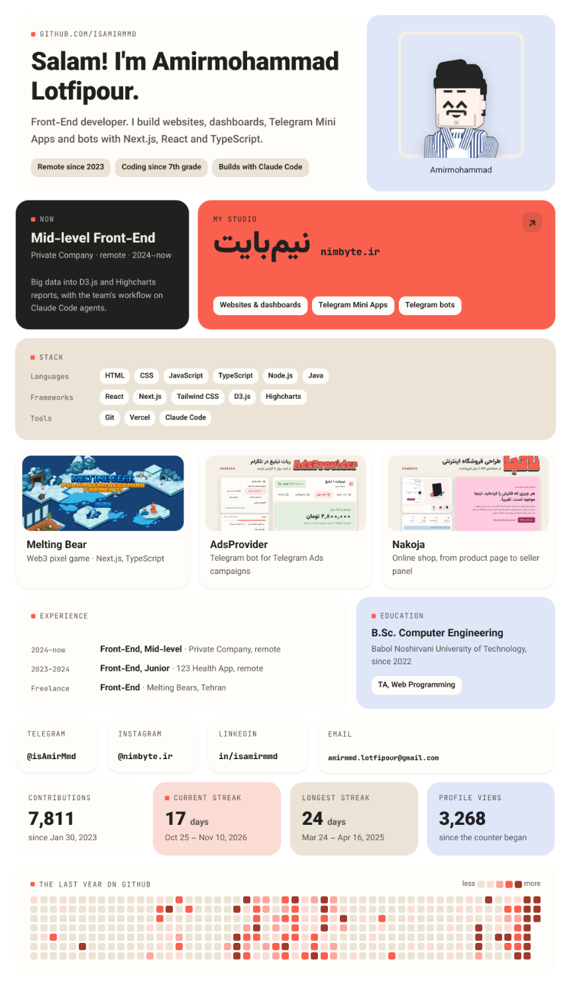
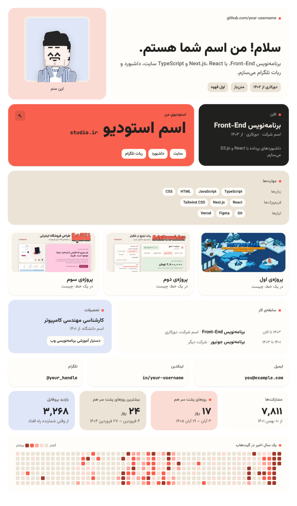

# nim-byte-readme-maker

A skill for AI coding agents that makes a **bento-grid GitHub profile README** in the
[نیم‌بایت (nimbyte)](https://nimbyte.ir) look: rounded tiles of different sizes on a cream ground,
your intro, what you do now, your stack, projects with real screenshots, experience, contacts,
and live stats tiles that a GitHub Action redraws every six hours. English (left to right) or
Persian (right to left). It's the README on [github.com/IsAmirMmd](https://github.com/IsAmirMmd).

<p align="center">
  
  
</p>

## How it works

GitHub strips CSS from READMEs, so the grid is made of images: each tile is drawn from one file,
`.bento/profile.json`, into a PNG by Chromium, and the README sets them side by side with
percentage widths, so it scales down to a phone and has a dark-theme variant. Everything lives
in your profile repo, so you (or any agent) can change one line and rebuild. The details are in
[`skills/bento-readme/references/design.md`](skills/bento-readme/references/design.md).

## Use it with your agent

The skill is [`skills/bento-readme/`](skills/bento-readme/), in the open `SKILL.md` format, and
its scripts are plain Node.js, so it works with any agent that can read files and run commands.

- **Claude Code:** copy the folder into your skills, then ask for a profile README:
  ```bash
  git clone https://github.com/IsAmirMmd/nim-byte-readme-maker
  ```
  ```bash
  cp -r nim-byte-readme-maker/skills/bento-readme ~/.claude/skills/
  ```
  (Or run Claude Code inside this repo: it loads the skill from `.claude/skills/`.)
- **Codex, Cursor, Copilot, Gemini CLI and others:** clone this repo, then tell the agent
  *"Make me a GitHub profile README with nim-byte-readme-maker/skills/bento-readme/SKILL.md"*.
  Inside this repo they find it on their own through `AGENTS.md`.

Then just ask, in English or Persian: *"make my GitHub profile README in bento style"*,
*«یه ریدمی بنتو برای پروفایل گیت‌هابم بساز»*. The agent reads your current profile, asks for
what it can't find, asks for real screenshots of your projects, builds the tiles, shows you
previews and pushes to `<you>/<you>` when you say so.

## Use it by hand

You need Node.js 18+ and your profile repo (a public repo named exactly like your username).

```bash
node nim-byte-readme-maker/skills/bento-readme/scripts/init.mjs path/to/your-profile-repo --lang en --stats
```
```bash
cd path/to/your-profile-repo && npm i --no-save playwright && npx playwright install chromium
```

Edit `.bento/profile.json` (put your pictures in `.bento/images/`), then:

```bash
node .bento/scripts/build.mjs
```
```bash
node .bento/scripts/preview.mjs
```

Look at `.bento/build/preview-*.png`, then commit and push. With `--stats`, the workflow in
`.github/workflows/bento-stats.yml` adds the stats tiles after the first push.

## فارسی

این یه skill برای ایجنت‌های هوش مصنوعیه که برای پروفایل گیت‌هاب یه README به سبک بنتو گرید
نیم‌بایت می‌سازه: کاشی‌های گرد روی زمینه‌ی کرم، با معرفی، کار فعلی، مهارت‌ها، نمونه‌کارها با
اسکرین‌شات واقعی، سابقه، راه‌های تماس و آمار زنده‌ی گیت‌هاب که هر شش ساعت به‌روز می‌شه. هم
فارسی (راست به چپ) و هم انگلیسی (چپ به راست). با Claude Code، Codex، Cursor، Copilot،
Gemini CLI و هر ایجنتی که فایل بخونه و دستور اجرا کنه کار می‌کنه: ریپو رو clone کنید و از
ایجنتتون بخواید با `skills/bento-readme/SKILL.md` ریدمی پروفایلتون رو بسازه.

## Credits

Made by [Amirmohammad Lotfipour](https://github.com/IsAmirMmd) for
[نیم‌بایت](https://nimbyte.ir). Fonts: [Vazirmatn](https://github.com/rastikerdar/vazirmatn) and
[JetBrains Mono](https://github.com/JetBrains/JetBrainsMono), both SIL Open Font License 1.1.
Profile views by [komarev.com](https://komarev.com/ghpvc/).
